# Preuves d'exécution

Environnement : Windows + WSL2 (Ubuntu), Docker Desktop, LocalEmu lancé dans Docker.

Avant les tests :

```bash
source ~/localemu-env/bin/activate
cd ~/M2_Cloud_computing_serverless/TP1_bis_AWS
./scripts/deploy.sh
source .env.local
```

---

## 0. La cible est l'émulateur local, pas AWS

```bash
awsemu sts get-caller-identity
```

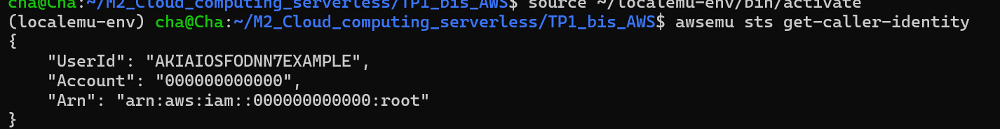

---

## 1. Les ressources existent dans LocalEmu

```bash
awsemu sqs list-queues
awsemu dynamodb list-tables
awsemu lambda list-functions --query 'Functions[].[FunctionName, Runtime, State]' --output table
awsemu lambda list-event-source-mappings --query 'EventSourceMappings[].[FunctionArn, EventSourceArn, State]' --output table
awsemu apigateway get-rest-apis --query 'items[].[name, id]' --output table
```

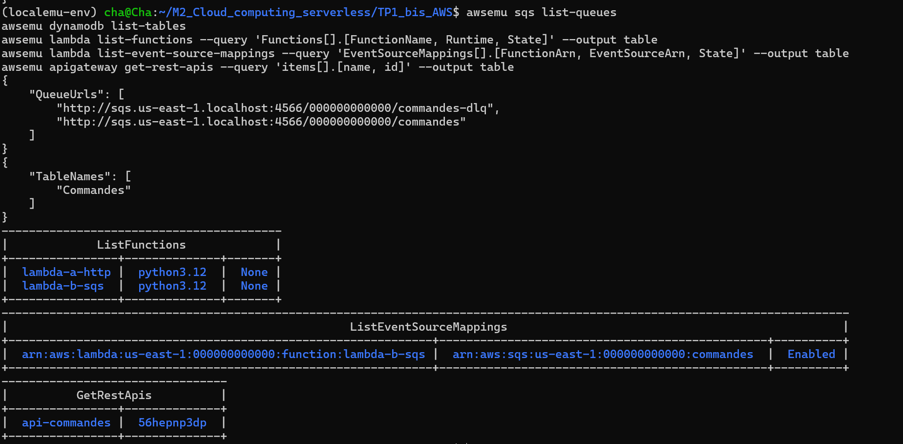

---

## 2. Tests unitaires

```bash
python3 -m pytest -v
```

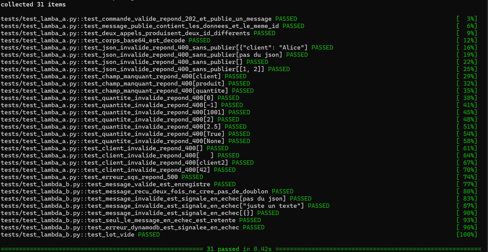

---

## 3. Appel avec des données valides

```bash
curl -i -X POST "$API_URL" \
  -H "Content-Type: application/json" \
  -d '{"client": "Alice", "produit": "Clavier", "quantite": 2}'
```

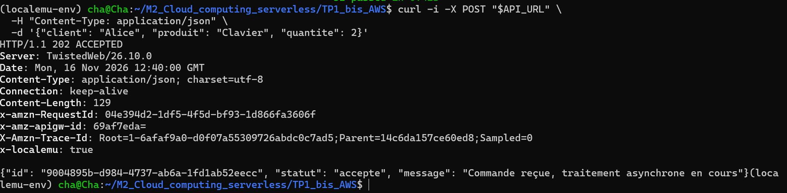

Quelques secondes plus tard, en remplaçant `ID` par l'id reçu :

```bash
awsemu dynamodb get-item --table-name Commandes --key '{"id": {"S": "ID"}}'
```

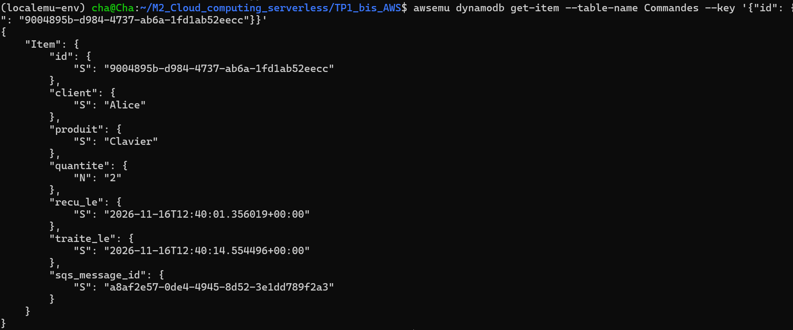

**Constat :** le message a traversé API Gateway → Lambda A → SQS → Lambda B → DynamoDB
sans aucune intervention manuelle.

---

## 4. Plusieurs appels successifs avec des données distinctes

```bash
curl -s -X POST "$API_URL" -H "Content-Type: application/json" -d '{"client": "Bruno",   "produit": "Souris", "quantite": 1}'; echo
curl -s -X POST "$API_URL" -H "Content-Type: application/json" -d '{"client": "Chloé",   "produit": "Écran",  "quantite": 3}'; echo
curl -s -X POST "$API_URL" -H "Content-Type: application/json" -d '{"client": "Damien",  "produit": "Casque", "quantite": 5}'; echo
sleep 5
awsemu dynamodb scan --table-name Commandes \
  --query 'Items[].[client.S, produit.S, quantite.N, recu_le.S, traite_le.S]' --output table
```

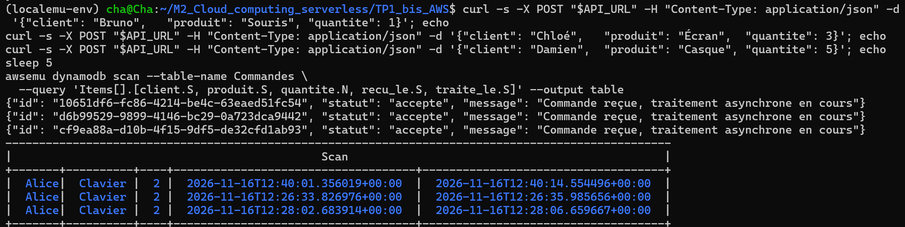

**Constat :** chaque appel produit un `id` distinct et un item distinct en base.

---

## 5. Appels avec des données invalides

```bash
awsemu dynamodb scan --table-name Commandes --select COUNT --query Count

curl -i -X POST "$API_URL" -H "Content-Type: application/json" -d '{"client": "Alice"'
curl -i -X POST "$API_URL" -H "Content-Type: application/json" -d '{"client": "Bob", "quantite": 1}'
curl -i -X POST "$API_URL" -H "Content-Type: application/json" -d '{"client": "Bob", "produit": "Stylo", "quantite": -3}'

sleep 5
awsemu dynamodb scan --table-name Commandes --select COUNT --query Count
```

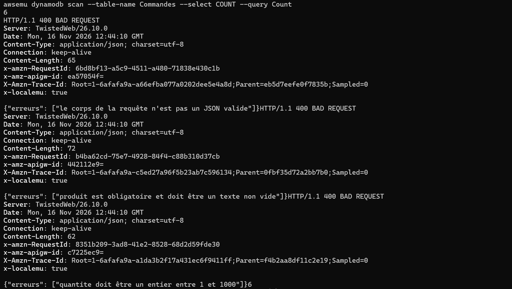

**Constat :** les données invalides sont rejetées par la Lambda A (HTTP 400), ne sont
pas envoyées dans SQS, et le nombre d'items en base ne change pas.

---

## 6. La réponse HTTP n'attend pas la fin du traitement asynchrone

On désactive temporairement le déclenchement de la Lambda B :

```bash
awsemu lambda update-event-source-mapping --uuid "$ESM_UUID" --no-enabled \
  --query State --output text
sleep 10

curl -i -X POST "$API_URL" \
  -H "Content-Type: application/json" \
  -d '{"client": "Diane", "produit": "Tablette", "quantite": 1}'
```

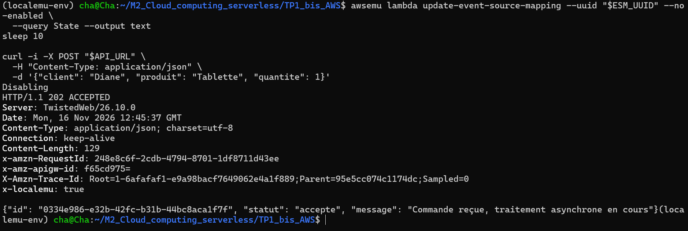

La commande n'est pas en base, mais elle attend dans la file (remplacer `ID`) :

```bash
awsemu dynamodb get-item --table-name Commandes --key '{"id": {"S": "ID"}}'
awsemu sqs get-queue-attributes --queue-url "$QUEUE_URL" \
  --attribute-names ApproximateNumberOfMessages
```

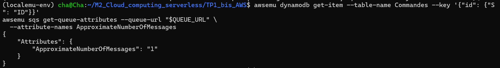

On réactive le déclencheur :

```bash
awsemu lambda update-event-source-mapping --uuid "$ESM_UUID" --enabled \
  --query State --output text
sleep 10
awsemu dynamodb get-item --table-name Commandes --key '{"id": {"S": "ID"}}'
```

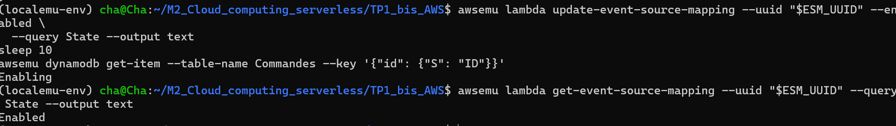

**Constat :** le `202` signifie seulement « reçu » : la commande n'est enregistrée
que lorsque la Lambda B a consommé le message.

---

## 7. Logs des deux Lambda

```bash
awsemu logs filter-log-events --log-group-name /aws/lambda/lambda-a-http \
  --query 'events[].message' --output text | tail -20
awsemu logs filter-log-events --log-group-name /aws/lambda/lambda-b-sqs \
  --query 'events[].message' --output text | tail -20
```

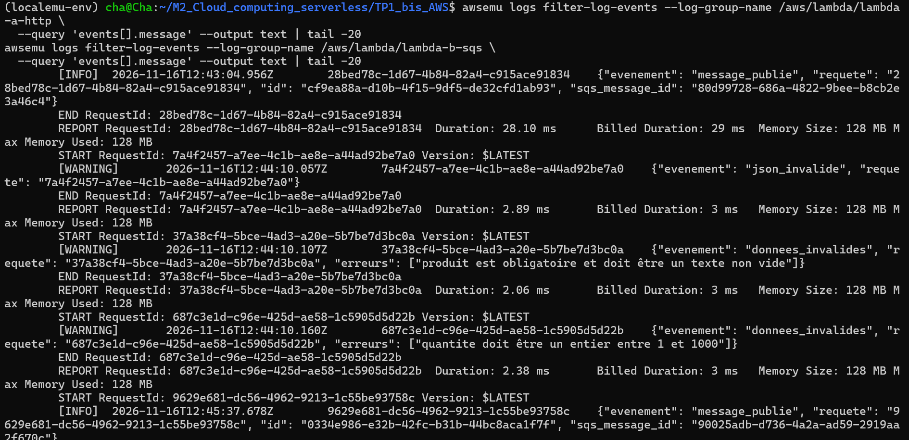

## Conclusion

Les tests réalisés permettent de vérifier le bon fonctionnement de l’architecture AWS en local avec LocalEmu. Les commandes envoyées via HTTP sont bien transmises à SQS, puis traitées par la deuxième Lambda et enregistrées dans DynamoDB.

Les tests avec plusieurs commandes et des données invalides ont également donné les résultats attendus. Enfin, le test de désactivation temporaire du déclencheur SQS de la Lambda B a permis de vérifier que la réponse HTTP n’attend pas l’enregistrement final dans DynamoDB.

L’ensemble du parcours fonctionne donc conformément à l’architecture demandée dans le TP, sans utiliser de services AWS réels.
